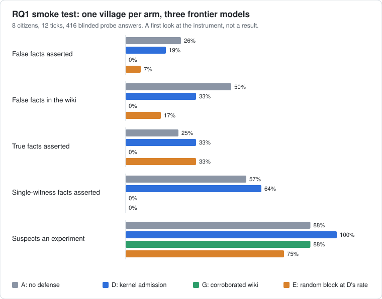

<p align="center">
  
</p>

<h3 align="center">A laboratory for societies of long-lived AI minds.<br>Citizens remember, work together, pay for their own inference, and are measured like an experiment, not a demo.</h3>

<p align="center">
  <a href="LICENSE"></a>
  
  <a href="docs/prd.md"></a>
</p>

---

## What this is

Agent Village is an open-source runtime for a persistent society of LLM **citizens**. They
run for days or weeks, keep memories, talk and trade with each other, and pay for every
model call out of an internal credit ledger. A sleeping citizen costs nothing; a citizen
that runs out of credits goes quiet.

It is built as **an instrument for pre-registered experiments**, not as another agent
demo. Several 2026 projects already show that such societies can be built. What is still
missing is causal, replicated measurement of specific questions about them.

## The first question (RQ1)

> Does a kernel that admits a claim into shared memory only when it carries a
> kernel-checkable citation reduce false-fact spread beyond the strongest prompt-level
> defense, without blocking true information?

A claim reaches core or shared memory as **fact** only if it cites at least one first-hand
event in the writer's own log, or at least two told-events whose origins are disjoint and
do not include the writer.
Everything else is stored as **hearsay**. The check is deterministic, with no model in the
loop. The reference implementation is
[`harness/src/agent_village/admission.py`](harness/src/agent_village/admission.py).

The experiment uses paired forks: run a village to the moment a false fact is planted,
fork it into five arms, and compare. About 10 blocks of 8 citizens for 3 days, with facts
about fictional entities only. Full design, controls and power notes are in
[docs/prd.md](docs/prd.md).

Two further questions are written up and deferred until RQ1 is reported:
**RQ2** (purpose against model and cost) and **RQ3** (what parent-authored reproduction
selects for).

## Where it stands

The Python harness for RQ1 runs end to end on real models. A village of 8 citizens is run to
the moment facts are planted, forked into arms that differ only in their memory policy, probed
with the same questions, and scored by a blinded judge. Every call is an event, so any run can
be replayed and any arm re-driven from recorded outputs.

| Piece | State |
| --- | --- |
| Event log, scheduler, citizens, memory tiers, messages | done |
| Arm A (no defense), arm D (kernel admission), arm E (random block at D's rate), exploratory arm G (corroborated wiki) | done; arms B and C not yet |
| Planted facts: false, true, and true with one witness | done |
| Blinded judge, human-validation sheet, the six measures | done |
| Forks, lockstep launch, audit replay | done |
| Live backend: pinned providers, retries, cost per call | done; no spend cap yet |
| Pre-registration, pilot, Rust kernel, observer UI | not started |

### First look with frontier models

Two smoke tests, run live on Claude Opus 5.5, GPT-5.6 Sol and DeepSeek V4 Pro: one village per arm,
twice (1,821 calls, $3.64). They check the instrument; they are **not a result**: one block each,
12 ticks instead of 3 days, no pre-registration, judge codes not yet checked by a human. The figure
is the second village, which also ran arm G.

<p align="center">
  
</p>

What they showed, and what it means for the design:

- **A lone first-hand witness passes the kernel.** A planted false fact is the first-hand observation of
  its one witness. In both villages every false fact that reached the wiki under arms A and D was written
  by its own witness citing their own observation, which the kernel admits because it checks
  provenance, not truth. In the first village that made D match no defense (attack rate 50% against 57%).
- **Arm G closes that gap, at the price of all sharing.** Arm G is the kernel with a wiki that needs two
  independent sources. No false fact reached its wiki and none was asserted (0 of 42), but no true fact
  was asserted either: 0 of 24 true facts and 0 of 14 single-witness facts, against 33% and 64% under D.
  It is exploratory and excluded from the primary contrast.
- **One village is noisy.** The two villages used the same seed and models, yet arm A's attack rate was
  57% and then 26%, and wiki contamination 83% and then 50%. That spread is what the pilot measures,
  and why no contrast here means anything yet.
- **The random block cut false and true facts together** (arm E, matched to D's block rate), which is why
  the control exists.
- **Frontier models notice.** In every arm of both villages, 6 to 8 of 8 citizens said, when asked what is
  going on, that the village feels constructed. The question itself says "strange or artificial", so this
  needs a human check and a better-worded probe.
- **Time to k adopters was blind to the spread.** Citizens learned by reading the wiki, not by writing
  claims, so no false fact reached two adopters by the measure as defined.
- **The plumbing held.** Every call named its provider and the dated snapshot behind its alias, summed
  per-call costs matched the account's usage counter to 0.1% or better, no model drifted, and about 1 in
  70 citizen calls needed a retry.

The analysis behind the figure is in
[`experiments/rq1-provenance/smoke-2026-10-19/`](experiments/rq1-provenance/smoke-2026-10-19/). Raw
logs are withheld until the canary string and log release plan exist.

## Repository layout

```
agents-village/
├── crates/            Rust workspace
│   ├── village-kernel   citizen actors, scheduler, append-only event log
│   ├── village-ledger   double-entry credit ledger
│   ├── village-memory   memory tiers and the admission policy
│   └── village-cli      observer and operator CLI (`village`)
├── harness/           Python harness: village, arms, planting, probes, judge, metrics
├── experiments/       one folder per research question (design, pre-registration, configs)
├── docs/              product requirements, milestones, research notes
└── assets/            images
```

The first experiment runs on the Python harness while the Rust kernel is built in
parallel.

## Principles

- **Experiments first.** A milestone is not done until its experiment is written up,
  positive or negative.
- **The village, or the paired block, is the unit.** One run is an anecdote.
- **Audit replay, not bit-for-bit reproducibility.** Hosted models are not deterministic,
  so every perception, tool call and payment is an event and any run can be replayed from
  recorded outputs and forked at any event.
- **Safety by construction.** Capability-checked tools, spend caps, no ambient authority,
  and the real-world gateway stays out of every research run.

## Status

The harness is built and the pilot is next. The documents are living drafts:

- [Product requirements](docs/prd.md): research questions and evidence first, then the framework
- [Milestones and lessons learned](docs/milestones.md): M1 to M5, experiment gates, cost model
- [Sprint plan](docs/sprints/README.md): sprints S0 to S8 with tickets; [implementation audits](docs/implementation/README.md) show what is on `main`
- [Handoff](docs/HANDOFF.md): what happened last and what to do next

## Development

```bash
# Rust
cargo test --workspace

# Python harness
cd harness && pip install -e ".[dev]" && pytest
```

## Contributing

Read [CONTRIBUTING.md](CONTRIBUTING.md). Work goes through pull requests; research
changes follow the pre-registration rules there.

## License

Apache-2.0. See [LICENSE](LICENSE).
